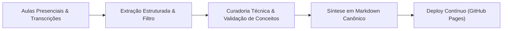

# 📚 ADS Senac Recaps — Central de Engenharia de Software & Base Técnica

<p align="left">
  
  
  <a href="https://jeronimo-jrsilva.github.io/ads-senac-recaps/"></a>
  <a href="https://github.com/jeronimo-jrsilva"></a>
  
</p>

---

### 📌 1. Visão Geral & Propósito

O **ADS Senac Recaps** é uma base viva de documentação técnica, notas aprofundadas de engenharia de software e resumos consolidados das disciplinas da graduação em **Análise e Desenvolvimento de Sistemas (ADS)** na Faculdade SENAC Ceará.

O projeto nasceu para transformar o vasto volume de informações teóricas e práticas de sala de aula em guias técnicos de consulta rápida, glossários conceituais rigorosos e referências de algoritmos, arquitetura de sistemas e conformidade de software.

> [!TIP]
> **ACESSO RÁPIDO AO PORTAL WEB:**  
> 👉 **[Clique aqui para navegar pelo Hub de Recaps no GitHub Pages](https://jeronimo-jrsilva.github.io/ads-senac-recaps/)**

---

### 🏗️ 2. Pipeline de Curadoria & Engenharia Documental



#### Destaques Metodológicos:
- **Rigor Conceitual:** Transformação de discussões práticas em documentação canônica (diagramas, tabelas comparativas, exemplos de código executáveis).
- **Acessibilidade:** Navegação multiplataforma estruturada por semanas e unidades curriculares com links diretos e busca facilitada.
- **Transparência de Requisitos:** Especificação formal de funcionalidades e escopo detalhada em [docs/requisitos.md](docs/requisitos.md).

---

### 🛠️ 3. Conteúdo Técnico Coberto

| Área do Conhecimento | Tópicos Centrais |
| :--- | :--- |
| **Lógica & Algoritmos** | Estruturas de controle, laços, vetores, matrizes e complexidade básica |
| **Programação Orientada a Objetos** | Classes, encapsulamento, herança, polimorfismo, interfaces e POO com Java |
| **Bancos de Dados & Modelagem** | Modelagem relacional (DER), SQL ANSI, PostgreSQL, MySQL e normalização de dados |
| **Arquitetura de Computadores** | Sistemas operacionais, hardware, barramentos, memória e assembly/binário |
| **Engenharia de Software & Ágil** | Scrum, Kanban, levantamento de requisitos, conformidade e governança de TI |

---

### 📂 4. Estrutura do Repositório

```text
ads-senac-recaps/
├── docs/                     # Documentação de requisitos e governança
│   └── requisitos.md
├── recaps/                   # Notas técnicas organizadas por período e semana
│   ├── semana_01/            # Introdução a Lógica e Arquitetura
│   └── semana_02/            # Estruturas Avançadas e Conformidade
├── index.html                # Portal interativo para GitHub Pages
├── styles.css                # Estilização visual moderna
└── README.md
```

---

### ⚖️ Isenção de Responsabilidade
Este é um projeto acadêmico independente e de iniciativa própria, criado para fins de pesquisa, estudo e apoio à comunidade acadêmica de ADS.

---

### 👤 Autor & Contato

<p align="left">
  <strong>Jeronimo Silva</strong><br>
  <em>Estagiário em Desenvolvimento de Software | Graduando ADS (SENAC Ceará)</em><br>
  Fortaleza - CE | Disponível para Presencial, Híbrido e Remoto
</p>

<p align="left">
  <a href="mailto:jeronimo.aulas@gmail.com"></a>
  <a href="https://linkedin.com/in/jeronimojr-dev" target="_blank"></a>
  <a href="https://github.com/jeronimo-jrsilva"></a>
</p>
