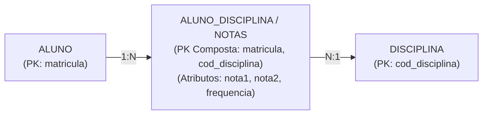

A quinta aula de **Banco de Dados Relacional** com o Professor Alexandre aprofundou a transição do pensamento de planilhas ("tabelões") para a arquitetura relacional normalizada. Foram debatidos os critérios para escolha de chaves primárias naturais vs. artificiais, o impacto computacional e a teoria dos conjuntos por trás das operações de `JOIN`, o tratamento de relacionamentos Muitos-para-Muitos ($N:N$) através de tabelas associativas e a resolução guiada de um estudo de caso prático de emissão de relatórios de vendas sob cenários de concorrência e redundância.

---

## 1. Postura Profissional em TI & O Uso Crítico da Inteligência Artificial

O Professor Alexandre iniciou a aula propondo uma reflexão sobre maturidade técnica no desenvolvimento de software:

* **A Ilusão da Aceleração Cega:** O perigo de utilizar ferramentas de IA generativa para gerar código e estruturas sem compreender a causa-raiz ou o funcionamento interno.
* **Critério de Sucesso Real:** O verdadeiro desenvolvedor não fica satisfeito apenas porque um script ou consulta "aparentemente funcionou" no teste simples. A excelência técnica reside em **saber exatamente por que funcionou**, prever cenários de borda (*corner cases*) e conseguir diagnosticar falhas quando as condições mudarem.
* **Composição Passo a Passo:** Em consultas complexas ou modelagens extensas, a abordagem segura é construir incrementalmente — estruturando e validando tabela a tabela antes de tentar unir dezenas de entidades de uma só vez.

---

## 2. Da Planilha ao Modelo Relacional: Eliminação de Redundâncias

A evolução de um "Tabelão Único" (estilo planilha Excel) para entidades normalizadas resolve anomalias clássicas de banco de dados:

```
[ TABELÃO ÚNICO (Planilha) ]  ──►  Anomalia de Inserção, Atualização e Espaço Desperdiçado
             │
             ▼ Normalização
┌───────────────────────────┐     ┌───────────────────────────┐     ┌───────────────────────────┐
│     Tabela DISCIPLINA     │     │       Tabela ALUNO        │     │       Tabela PROFESSOR    │
│ (codigo_disc, nome, carga)│     │  (matricula, nome, email) │     │    (id_prof, nome, cpf)   │
└───────────────────────────┘     └───────────────────────────┘     └───────────────────────────┘
```

* **Regra Prática de Identificação:** Havendo dados repetindo valores textuais em múltiplas linhas (ex: nome do professor, dados da disciplina ou do aluno), há forte indício de necessidade de extração para uma tabela própria.
* **Integridade Semântica:** Cada tabela deve representar uma entidade conceitualmente autocontida.

---

## 3. Engenharia de Chaves Primárias (`PRIMARY KEY`) & Índices

* **Chaves Naturais vs. Chaves Substitutas (Artificiais / IDs):**
  - *Chave Natural:* Atributo inerente ao negócio que possui unicidade garantida (ex: `codigo_disciplina`, `CPF`, `matricula`). Sempre que existir uma chave natural confiável, ela deve ser priorizada.
  - *Chave Substituta (`id` auto-incremental):* Utilizada quando os dados de negócio não oferecem unicidade inequívoca ou quando a chave natural seria composta por múltiplos campos extensos.
* **Custo Computacional do Índice:** Toda chave primária gera internamente uma árvore de índice no SGBD. Chaves muito longas ou compostas por vários campos de texto aumentam o consumo de memória RAM e o tempo de processamento nas operações de inserção e busca.

---

## 4. Teoria dos Conjuntos, Cruzamento de Dados e o Custo do `JOIN`

* **Fundamentação Matemática:** O modelo relacional baseia-se na teoria dos conjuntos e na álgebra relacional. A junção (`JOIN`) realiza um produto cartesiano filtrado pelas chaves de ligação (`PRIMARY KEY` = `FOREIGN KEY`).
* **Quando Aceitar a Desnormalização?**
  - O padrão da engenharia é manter o modelo normalizado.
  - A desnormalização pontual (manter dados redundantes na mesma tabela) só é justificável em cenários de altíssima volumetria onde a consulta é executada milhares de vezes por segundo e o custo do `JOIN` inviabilizaria a latência do sistema.

---

## 5. Relacionamentos Muitos-para-Muitos ($N:N$) & Tabelas Associativas

Quando duas entidades possuem cardinalidade bidirecional máxima $N$ (ex: um aluno cursa várias disciplinas e uma disciplina possui vários alunos):



* **Resolução do $N:N$:** O modelo relacional decompõe o relacionamento em **duas relações $1:N$** conectadas por uma **Tabela Intermediária / Associativa**.
* **Chave Primária da Tabela Intermediária:** Composta pelo par das chaves estrangeiras (`matricula` + `codigo_disciplina`), garantindo que a combinação seja estritamente única.

---

## 6. Estudo de Caso Prático em Sala: "Relatório de Vendas"

A turma executou a modelagem guiada de um sistema comercial para geração de relatórios com: Vendedor, Produto, Data/Hora da Venda e Valor Vendido.

### Análise de Casos Pessimistas (Lei de Murphy no BD):
* **O Cenário de Colisão:** O mesmo vendedor vende o mesmo produto, no mesmo dia, no mesmo minuto e pelo mesmo valor para clientes diferentes.
* **Solução Arquitetural:** Chaves compostas puras por atributos de negócio falham nesse cenário. É mandatória a criação de uma entidade transacional `VENDA` com identificador exclusivo (`id_venda` / número sequencial da nota), relacionando o vendedor e os itens de produtos vendidos.

| Entidade | Chave Primária (PK) | Atributos Principais |
| :--- | :--- | :--- |
| **VENDEDOR** | `codigo_vendedor` | `nome`, `cpf`, `comissao` |
| **PRODUTO** | `codigo_produto` | `descricao`, `preco_unitario`, `categoria` |
| **VENDA / ITEM_VENDA** | `id_venda` | `codigo_vendedor` (FK), `codigo_produto` (FK), `data_hora`, `quantidade`, `valor_total` |

---

## Glossário
* **Chave Primária (PK):** Campo ou conjunto de campos que identifica unicamente um registro em uma tabela.
* **Chave Estrangeira (FK):** Campo que estabelece a integridade referencial apontando para a PK de outra tabela.
* **Tabela Associativa:** Tabela intermediária criada para resolver relacionamentos $N:N$, transformando-os em dois vínculos $1:N$.
* **JOIN:** Operação SQL que combina registros de duas ou mais tabelas com base em uma condição relacional.
* **Desnormalização:** Prática deliberada de introduzir redundância controlada em um modelo para ganho de performance em consultas analíticas específicas.
